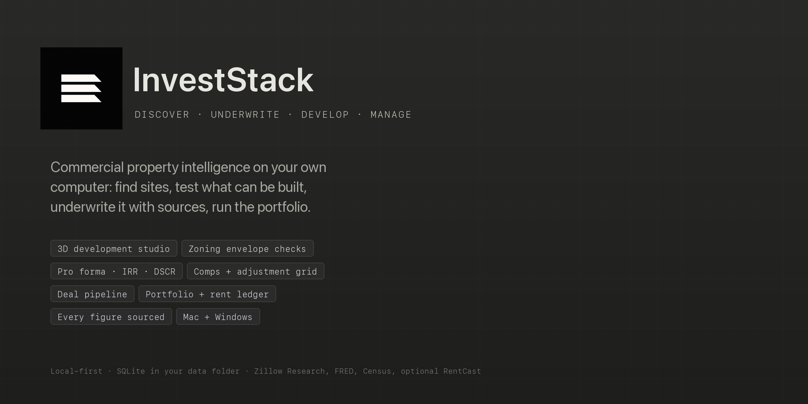

# InvestStack



A real-estate desk that runs on your own computer (macOS and Windows): find properties, underwrite them with the
source of every number shown, track deals through a pipeline, and run the properties you own: rent roll, ledger,
expenses, debt and a Schedule-E style report. A local Python engine stores everything in SQLite on your machine; the
interface is a web app shown in a native window.

It starts in a **demo workspace** (a synthetic market and portfolio around Columbus, OH). Switch to your own workspace
in Settings.

## Pages

| # | Page | What it does |
|---|------|--------------|
| 1 | Search | Listings on a map and in a dense table, scored; pull live listings (RentCast), saved searches |
| 2 | Screen | Listings ranked by score with factor contributions, weight editor, strategy presets |
| 3 | Market | ZIP / metro home-value and rent indexes, yields, mortgage rate and 10-year Treasury |
| 4 | Property | Profile: facts, value and rent estimates with range and source, taxes, sales, 3D map, Street View, what's missing |
| 5 | Comps | Sale and rent comps with an adjustment grid, include/exclude, reconciled value |
| 6 | Underwrite | Rental / BRRRR / flip model: pro forma, IRR, DSCR, sensitivity grid, max offer, saved scenarios |
| 7 | Pipeline | Kanban of deal stages with checklists, tasks and an event log |
| 8 | Portfolio | What you own: value, debt, equity, NOI, cash flow, occupancy, lease expiries |
| 9 | Rent roll | Units, tenants and leases; vacancy, loss to lease, renewals |
| 0 | Ledger | Rent charges and payments per lease, arrears ageing |
| | Books | Expenses by Schedule E category, loans and amortisation, maintenance tickets |
| | Inbox | Drop bank CSVs, leases and mortgage statements; review proposed matches and extracted fields |
| | Reports | Schedule-E style report per property and year, owner statement, rent-roll export (not tax advice) |
| | Settings / Help | Workspace, API keys, RentCast budget, market data, data folder; keys and formulas |

## Quick start (from a checkout)

Python 3.12.

```bash
python3.12 -m venv .venv
.venv/bin/pip install -r requirements-dev.txt     # Windows: .venv\Scripts\pip ...
.venv/bin/python desktop/main.py                  # native window
.venv/bin/python -m valora serve                  # or: engine only, open http://127.0.0.1:8780
.venv/bin/python -m unittest discover -s tests
```

`desktop/main.py` uses port 8780, or any free port if 8780 is taken, and writes its log to `valora.log` in the data folder.

## Building the desktop app

**macOS** (on a Mac):

```bash
.venv/bin/python tools/make_app.py             # -> dist/InvestStack.app (PyInstaller, ad-hoc signed)
.venv/bin/python tools/make_app.py --install   # also copies it to ~/Applications
```

**Windows** (on Windows, with [Inno Setup 6](https://jrsoftware.org/isinfo.php)):

```bat
.venv\Scripts\python tools\make_app.py         :: -> dist\InvestStack\InvestStack.exe
iscc desktop\installer.iss                      :: -> dist\InvestStack-Setup-0.1.0.exe
```

The installer puts InvestStack in Program Files, adds a Start Menu shortcut (desktop shortcut optional), and installs the
Microsoft Edge WebView2 Runtime if it is missing (Windows 11 already has it).

**CI:** `.github/workflows/build.yml` builds both on a `v*` tag (or by hand): macOS zip + dmg, Windows installer,
attached to the GitHub release.

Icons and the banner are drawn by `tools/art.py` (`.venv/bin/python tools/art.py` re-renders all of them).

## Where data and keys live

| OS | Data folder |
|----|-------------|
| macOS | `~/Library/Application Support/InvestStack (existing Valora folder reused)` |
| Windows | `%APPDATA%\InvestStack` (existing Valora folder reused) |
| Linux | `~/.local/share/valora` |

It holds `valora.db` (your workspace), `valora-demo.db`, `config.toml` (settings and API keys, entered in Settings),
downloaded market files and `valora.log`. `VALORA_HOME` overrides the location. Nothing is stored in the app bundle or
the repo, and the page only learns whether a key is set, never the key. Uninstalling does not delete this folder.

## Data sources

| Source | Used for | Terms |
|--------|----------|-------|
| [Zillow Research](https://www.zillow.com/research/data/) public CSVs (ZHVI, ZORI) | ZIP / metro home value and rent indexes | Free downloads; cite Zillow. ZIP-level, not property-level |
| [FRED](https://fred.stlouisfed.org/) (St. Louis Fed) | Mortgage rates, 10-year Treasury, vacancy, Case-Shiller | Public CSV, no key |
| [US Census Geocoder](https://geocoding.geo.census.gov/) | Address to coordinates and tract | Free, no key |
| OpenStreetMap Nominatim | Geocoding fallback | Usage policy: light use, attribution |
| [RentCast API](https://www.rentcast.io/api) (optional key) | Property records, value / rent estimates with comps, live listings | 50 free calls a month; paid beyond that. InvestStack counts calls and stops at the monthly budget you set |
| [OpenFreeMap](https://openfreemap.org/) / OpenStreetMap | Map tiles, 3D buildings | Free; © OpenStreetMap contributors |
| Google Maps (optional key) | Street View link; inline embed with a Maps Embed API key | Google Maps terms |

## Limits (honest)

- **No Zillow scraping.** Zillow's terms prohibit it. InvestStack uses only Zillow's published research CSVs. Property-level
  values and listings come from RentCast (your key) or what you enter.
- **Unsigned app.** The Mac build is ad-hoc signed, not notarized: the first time, right-click InvestStack.app, choose Open,
  then Open (or allow it in System Settings, Privacy & Security). On Windows, SmartScreen may say it "protected your PC":
  choose More info, then Run anyway.
- **Demo data is synthetic.** Everything labelled DEMO is made up for illustration.
- Estimates are estimates: each shows its source and date; ZIP indexes are labelled as ZIP-level. Reports are
  Schedule-E style, not tax advice.

## Keys

`1`–`9`, `0` jump to pages · `←` `→` (`[` `]`) previous / next page · `↑` `↓` (`j` `k`) move in a table ·
`/` address / command bar · `⌘K` (Ctrl+K) command palette · `A` add an address · `I` inbox · `T` light / dark ·
`?` help · `Esc` clear the selection.

## Commands

```bash
.venv/bin/python -m valora serve [port]                  # engine + web app on 127.0.0.1
.venv/bin/python -m valora api GET /api/state            # any GET route as JSON
.venv/bin/python -m valora api POST /api/underwrite '{"strategy":"rental","inputs":{"price":200000,"rent_month":2000}}'
.venv/bin/python -m valora demo                          # rebuild the demo workspace
.venv/bin/python -m valora market [force]                # download / refresh market indexes
```
